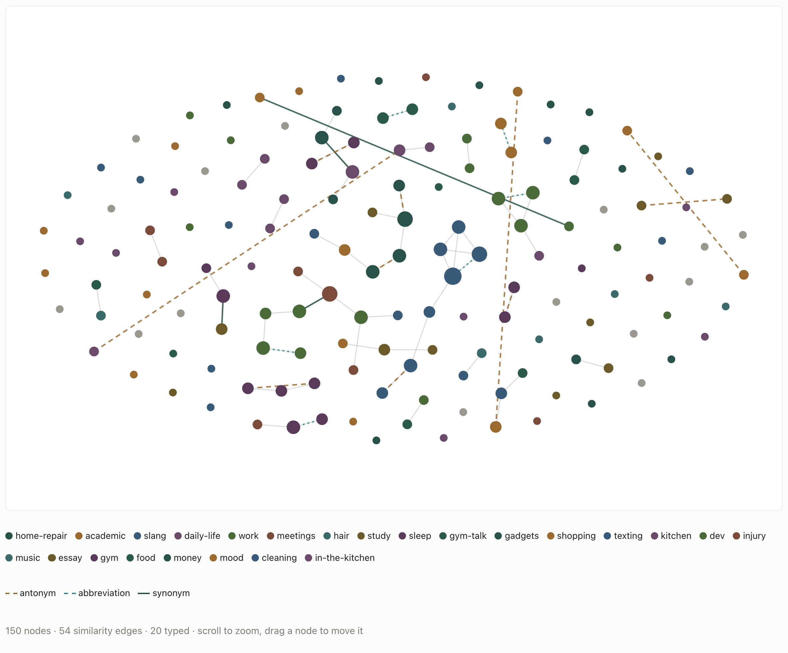
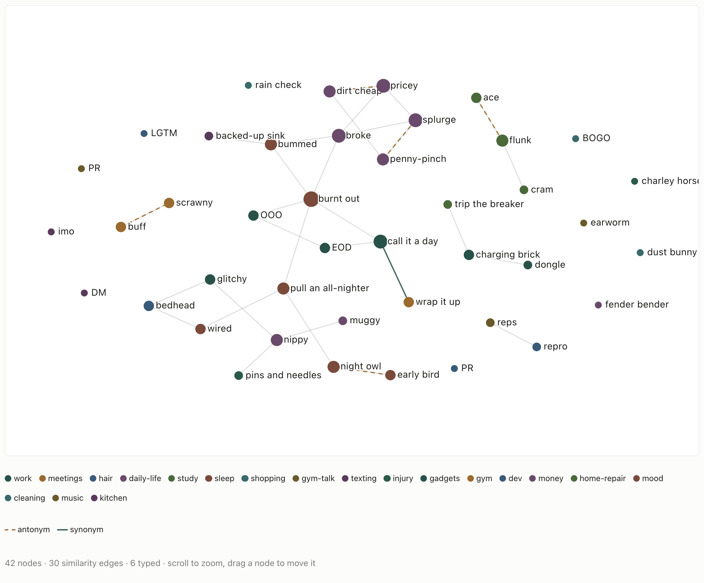
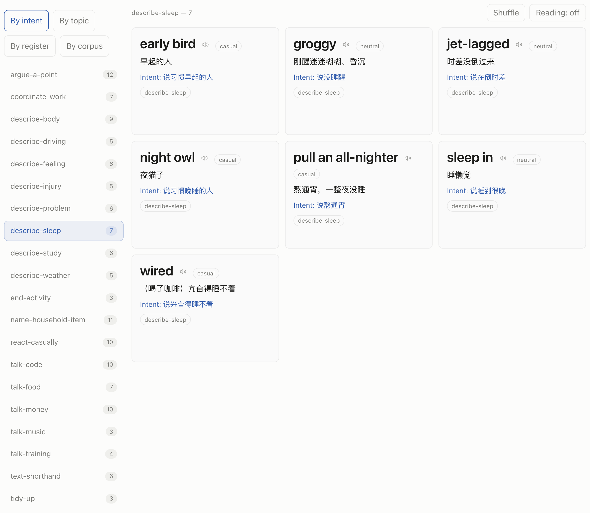
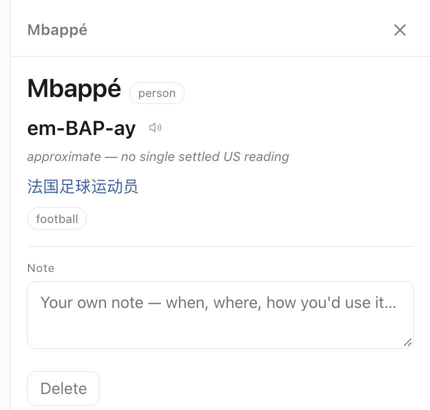
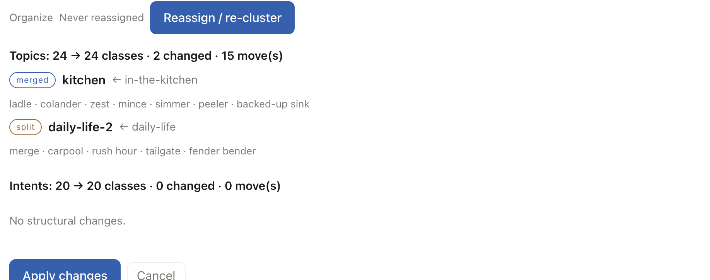

# Expression Vault

Your private, topic-and-intent-organized vault of English expressions, fed by
low-friction capture entries (a quick word-lookup, a Q&A box for "I don't
understand this", and an idiomatic Chinese→English box), and retrievable the
moment you next need it. Full register spectrum, street slang to academic to
technical.

You can read a word fine, yet not recall you can use it in a given situation,
and you look things up and forget them. Expression Vault makes asking AI the act
of capturing, and lets you retrieve expressions by what you want to say, not just
by how they're spelled.

<p align="center">
  
</p>

The Knowledge Graph over all 150 entries of the demo vault. Grey lines join words
whose embeddings clear a cosine threshold you set with a slider; solid green,
dashed brown and dotted teal lines are typed relations (synonym, antonym,
abbreviation). Colour is the word's first topic tag. At this threshold about
half the words have no neighbour at all, and nearly half of the grey edges join
two different topics: the vectors and the tags disagree about what belongs
together.

<p align="center">
  
</p>

The same view over the 42 casual-register entries, with labels on. `call it a
day` (work) and `wrap it up` (meetings) are near-synonyms filed under different
topics, which is the kind of split the graph is for finding. Each antonym pair
(`ace` / `flunk`, `night owl` / `early bird`, `pricey` / `dirt cheap`) sits close
together, because distance measures topic, not polarity.

> **About the data.** Every screenshot and example in this README comes from
> [`data/sample/vault.json`](data/sample/vault.json), a synthetic demo vault of
> 150 hand-written entries produced by
> [`tools/make-sample-vault.mjs`](tools/make-sample-vault.mjs). It is not a
> record of anyone's real usage. Its tags drift on purpose (a `gym-talk` tag next
> to `gym`, a catch-all `daily-life`) so the regrouping step has something to fix.
> Load it from **Settings → Sync & data → Load sample vault**.

## Ask by intent

The core lookup is a reverse index: start from what you are trying to say, end
at the expressions that say it. Every card carries `intents` (what the speaker is
doing), `topics`, a `register` and a `corpus` scene, and Retrieve browses any of
those axes.

Picking the intent `describe-sleep` in the demo vault returns:

| Expression | Register | Note on the card |
|---|---|---|
| `night owl` | casual | 夜猫子 |
| `early bird` | casual | 早起的人 |
| `pull an all-nighter` | casual | 熬通宵，一整夜没睡 |
| `sleep in` | neutral | 睡懒觉 |
| `groggy` | neutral | 刚醒迷迷糊糊、昏沉 |
| `wired` | casual | （喝了咖啡）亢奋得睡不着 |
| `jet-lagged` | neutral | 时差没倒过来 |

<p align="center">
  
</p>

The search box covers the other direction, from Chinese. Typing `收工` returns
`call it a day`; `便宜` returns `dirt cheap`. That search is a plain substring
match over the surface, the Chinese gloss, the intent note and the tag names.
It does not use embeddings, so `熬夜` finds `burn the midnight oil` (开夜车、熬夜苦读)
and misses `pull an all-nighter`, whose gloss says 熬通宵. Those two are linked
only by a synonym relation on their cards and by an edge in the graph.

Names get their own card, because the point of looking up `Mbappé` is how to say
it. In the app the respelling comes from two strong models, and when they
disagree the card says so instead of picking one (the demo cards are written by
hand to show both cases):

<p align="center">
  
</p>

## Pipeline

One saved card moves through these stages. All of them run in the browser; the
only network calls are to the LLM and embedding providers you configure, with
your own keys.

`capture → save → embed → regroup → relate → retrieve → graph → sync`

| Stage | Input → output | What happens when it fails |
|---|---|---|
| **Capture** (`src/capture/qa-box.js`, `src/ai/candidate.js`) | a word, a pasted line plus a question, or a Chinese sentence → one or more candidate cards with gloss, register, `sense_key`, tags and relations | Nothing is stored until you press Save, so a wrong sense or a throwaway question never reaches the vault. |
| **Save** (`src/db/index.js`) | candidate → IndexedDB row; topic and intent tags are upserted in the same transaction | Live tagging reuses existing tags when it can, but drift still happens (`gym-talk` beside `gym`). Regrouping is the fix, not a stricter prompt. |
| **Embed** (`src/reassign/index.js`) | the English surface followed by the Chinese gloss → a 1536-d vector from OpenAI `text-embedding-3-small` by default (Gemini and Mistral are selectable), computed once at save | No embedding key, or a CORS failure, defers it silently. Regroup and the graphs embed whatever is missing when they next run. DeepSeek and Moonshot have no embedding endpoint. |
| **Regroup** (Settings → Organize) | every word on an axis, with its gloss and current tag → one LLM call per axis that assigns each word a group → a diff against the old tags (kept, merged, split, new) shown as a preview | Nothing is written until you apply. A word the model skips keeps a group of its own; a failed naming call falls back to a slug of a member. Two runs over the same vault can differ. |
| **Relate** (graph detail panel, "Classify visible") | one word plus its 8 nearest neighbours by cosine → the model labels each pair synonym, antonym, progression, collocation, abbreviation or none → typed edges | If the true partner is not among the 8 nearest, it cannot be found. |
| **Retrieve** (`src/retrieve/index.js`) | an axis value or a search string → cards | Search is substring only (see `熬夜` above). |
| **Graph** (`src/retrieve/graph.js`, `src/knowledge/graph.js`) | stored vectors → edges at a live cosine threshold plus a force layout, both in the browser | Above 150 nodes both views skip the O(N²) edge and layout pass and fall back to a ring. Words with no edge have nothing holding them in place; the Knowledge Graph's centring pull is sized against the crowd's repulsion (`src/knowledge/layout.js`) so they stay inside the canvas. |
| **Sync** (`src/sync/dropbox.js`) | the whole vault as one JSON file, by export/import or Dropbox | Merge is last-write-wins per record. Deletes travel as tombstones, kept 90 days, so a stale copy on another device cannot bring a deleted card back. |

<p align="center">
  
</p>

A regroup preview on the demo vault (this run used DeepSeek). It folded the
drifted `in-the-kitchen` tag back into `kitchen` and pulled the driving words
out of the catch-all `daily-life`. The name `daily-life-2` is real output: the
model's name for the split-off half collided with the name the other half kept,
and the app's collision rule appended a number. Groups that did not change are
not listed, and two runs over the same vault can come back different.

## What didn't work

**Grouping words by a cosine threshold.** The first regroup clustered words as
connected components over "cosine ≥ threshold" and mapped the components back
onto the old tags. It merged near-duplicates and little else: words a person
would file together by theme, like `hairline`, `hair transplant` and `plugs`
under `hair`, stayed apart. The step now hands the whole axis to an LLM and keeps only the diff
and preview logic (`src/reassign/cluster.js`, commit `0c1ebaf`). The app still
uses a threshold in one place, the "related words split across tags" check in
Settings (`DEFAULT_THRESHOLD`, `src/reassign/index.js`). To see the gap on any
vault, compare the same-group and cross-group cosine bands that
`tools/eval_groups.py` prints.

This is also the answer to "why not k-means". k-means needs the number of groups
before it starts and trusts the geometry of the embedding space, and that
geometry is what failed here. The LLM picks the number of groups from the data
and may leave a word on its own.

**Expecting distance to say what kind of relation two words have.** Antonyms sit
close together: `groggy` and `wired` are both about sleep, and that is what the
vector captures; `groggy`'s nearest neighbour in the demo vault is `wired`. So
distance only proposes candidates (the 8 nearest) and the model assigns the
type. That has its own blind spot: `nippy` and `sweltering` are not inside each
other's 8 nearest, so the relation step is never shown that pair. Every word's
top 8 is listed by `python tools/eval_neighbors.py data/sample/vault.json
--audit-out nbr.csv --queries 150`.

**Expecting the vector to separate senses.** The text embedded is the English
surface followed by the Chinese gloss (`src/reassign/index.js:25`). When two
cards share a surface, as `salty` (咸) and `salty` (酸、不爽) do, each is the
other's nearest neighbour even though the glosses differ; so are the two `bass`,
`drill` and `merge` cards (same `eval_neighbors.py --audit-out` listing). Senses
are kept apart by `sense_key` on the card, not by the embedding.

**A projection computed outside the app.** The first graph projected exported
embeddings to 2D with PCA, which meant exporting, running a batch script and
importing again before anything could be drawn. It was replaced by edges and a
layout computed live from vectors already stored on each card (commit
`be32a28`). A batch tool that also merged and split tags with HDBSCAN was
removed later: the importer rebuilds tags from the cards, so its tag changes were
discarded on import.

**Asking models for IPA.** Names were first meant to be resolved to IPA and
spoken through SSML `<phoneme>` tags. A three-model test found the generated IPA
unreliable, and the browser's Web Speech API does not accept SSML anyway. The
app now asks two strong models for a plain respelling such as `duh-BROYN`, speaks
that, and flags disagreement as "approximate". The test table is in
[`docs/DECISION-LOG.md`](docs/DECISION-LOG.md) (D-18).

## Evaluation

There are two offline scripts that read an exported vault. They measure group
quality and neighbour quality separately:

- [`tools/eval_groups.py`](tools/eval_groups.py) asks whether the LLM's groups
  hold together in embedding space. It prints the cosine silhouette per axis and
  the same-group vs cross-group cosine distributions. `--audit-out` writes a
  sample of words with their group for a person to mark y/n, and `--audit-in`
  scores the marked file with a 95% Wilson interval.
- [`tools/eval_neighbors.py`](tools/eval_neighbors.py) asks whether a word's 8
  nearest neighbours, the list the relation step works from, are related at
  all. It prints how often they share a tag, next to the same rate for all words
  as a baseline. `--audit-out` / `--audit-in` run a 0/1/2 manual grading and
  report precision@1, @5 and @8.

No numbers are reported here. On the demo vault they would only describe data I
wrote by hand, and my own vault is too small for them to mean anything. The
scripts are there so you can run them on yours:

```bash
python3 -m venv venv && source venv/bin/activate
pip install -r requirements.txt          # numpy only

python tools/eval_groups.py data/sample/vault.json
python tools/eval_neighbors.py data/sample/vault.json

# manual audit on your own export (Settings → Sync & data → Export vault)
python tools/eval_groups.py my-vault.json --audit-out groups.csv --audit-n 40
python tools/eval_groups.py --audit-in groups.csv
```

## Quick start

```bash
npm install
npm run dev      # http://localhost:5173
npm run build    # → dist/  (static; deploy anywhere)
```

Open the app, go to **Capture**, pick a provider and paste your API key (stored
on-device only), and start saving. Keys never leave your browser.

To look around first without a key, open **Settings → Sync & data → Load sample
vault**. Its cards already carry embeddings, so Retrieve, Review, Timeline and
both graphs work straight away; capture, regrouping and relation typing need a
key.

<details>
<summary><b>Tech stack</b></summary>

- **App**: [Vite](https://vitejs.dev) + vanilla JS. Local store is IndexedDB,
  designed sync-friendly (stable `id` + `updated_at`). No personal data is
  bundled; the demo vault is loaded on demand and is synthetic.
- **Analysis**: two Python scripts under `tools/` (numpy only) that read an
  exported vault. The app does not depend on them.
- **Demo data**: `tools/make-sample-vault.mjs` writes `data/sample/vault.json`
  and embeds it with `text-embedding-3-small` when `OPENAI_API_KEY` is set
  (environment, `.env.local` or `.env`).

</details>

<details>
<summary><b>Repository layout</b></summary>

| Path | What is there |
|---|---|
| `src/capture/`, `src/ai/` | capture entries, candidate prompts, provider calls, model tiers, pronunciation consensus |
| `src/db/` | IndexedDB stores (expressions, tags, edges, tombstones, AI cache), export/import merge |
| `src/reassign/` | LLM regrouping and the kept/merged/split/new diff |
| `src/retrieve/`, `src/knowledge/` | Retrieve, Graph, Knowledge Graph |
| `src/review/`, `src/timeline/`, `src/dashboard/`, `src/settings/` | the remaining views |
| `src/sync/` | Dropbox PKCE client and merge-on-sync |
| `tools/` | demo-vault generator, eval scripts, Knowledge Graph layout bench |
| `data/sample/` | the synthetic demo vault |
| `docs/DECISION-LOG.md` | decisions D-00 to D-20 with the reasoning behind each |

</details>

<details>
<summary><b>Model tiers</b></summary>

Each provider offers **five graded models** (*T1 Frontier → T5 Fastest*), chosen
under **Settings → Providers → Models**. Only the Frontier tier follows new
releases: **Update models** reads each provider's live model list with your own
key, re-points T1 at whatever is strongest today, and swaps out any lower tier
the provider has retired (never promoting it past the tier above).

</details>

<details>
<summary><b>Deploy / self-host</b></summary>

This is a **static site**: `npm run build` emits `dist/`, which any static host
serves. `vite.config.js` uses a relative `base` so it works from a subpath.

- **GitHub Pages**: `.github/workflows/deploy.yml` builds and publishes `dist/`
  on every push to `main`. Only the app code (plus the synthetic demo vault) is
  served; no personal or captured data is ever bundled.
- **Netlify / Vercel / Cloudflare Pages**: point them at the repo with build
  `npm run build` and output dir `dist`.

Anyone can host their own copy. Each deployer supplies their own API keys (in the
app) and, for sync, their own Dropbox app key (below).

</details>

<details>
<summary><b>Sync (cross-device)</b></summary>

The vault is a single file (`vault.json`). Two ways to move it between devices:

1. **Manual**: Settings → Sync & data → **Export vault** / **Import vault**
   (always available, no setup).
2. **Dropbox**: connect once. The app pulls and merges on load, pushes a few
   seconds after each save or delete, and **Sync now** runs a full round trip.
   Merge is last-write-wins per record, deletes travel as tombstones, and an
   upload that races another device's write is retried after a fresh pull.

#### Why Dropbox (and not iCloud / Google Drive)

| Option | Auto on phone browser | Cost | Notes |
|---|---|---|---|
| Manual file | n/a | free | works everywhere; you move the file yourself |
| **Dropbox** | ✅ | free | pure-frontend PKCE → **connect once, stays connected**; no app-verification wall |
| Google Drive | ✅ | free | most universal, but SPA tokens expire hourly (recurring re-auth) and the app-data scope needs Google's verification (an "unverified app" warning until reviewed) |
| iCloud (CloudKit / native) | ✅ | **$99/yr** Apple Developer | best Apple-native feel; needs a paid account + packaging |

Dropbox wins for a no-backend web app: its PKCE flow hands the browser a
long-lived refresh token (log in once), and there's no verification gauntlet.

#### Set up Dropbox

1. [Create a Dropbox app](https://www.dropbox.com/developers/apps) → **Scoped
   access** → **App folder** → name it. Your vault lands in `/Apps/<name>/`.
2. **Permissions** tab: enable `files.content.read` and `files.content.write`.
3. **Settings** tab → **Redirect URIs**: add your app's URL. The app shows the
   exact URI to paste (Settings → Sync & data), e.g. `http://localhost:5173/`
   for dev or your Pages URL for production.
4. Copy the **App key** → Settings → Sync & data → paste → **Connect Dropbox**.
   Or put it in `.env` as `DROPBOX_APP_KEY` so every build picks it up.

The app key is not a secret in the PKCE public-client flow, so it's safe in
local settings. Your vault data stays in your own Dropbox app folder.

</details>

<details>
<summary><b>Privacy</b></summary>

Your vault lives in your browser (IndexedDB). AI calls go directly from your
browser to the provider you choose, with your own key, and nothing requires an
account to start. Sync, if enabled, goes to your own Dropbox. There is no server
operated by this project, and no captured corpus is ever committed to the repo:
`.env*` files, exports and everything under `data/` except the synthetic sample
are gitignored.

</details>

<details>
<summary><b>License</b></summary>

MIT, see [LICENSE](LICENSE). Never publish a captured corpus (copyright +
privacy).

</details>
